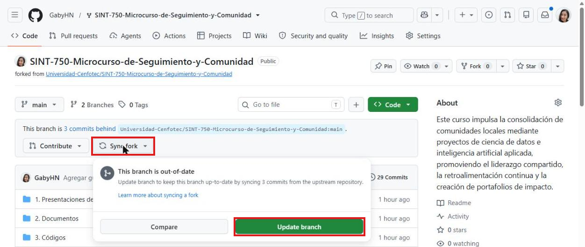
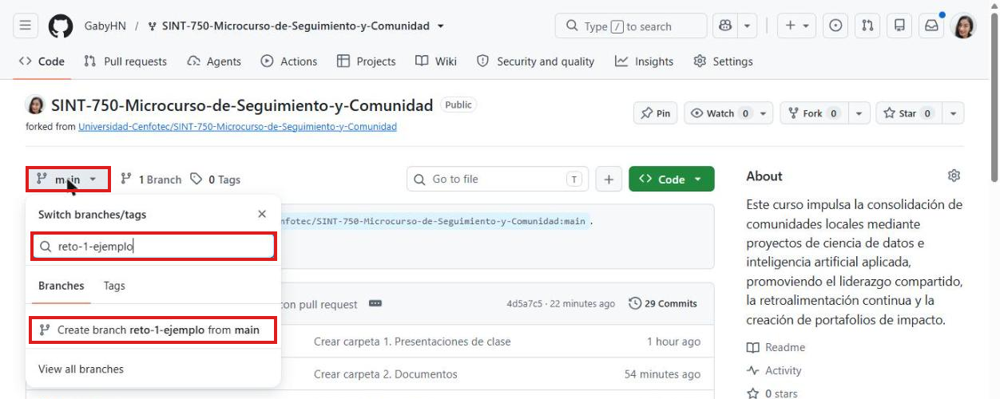
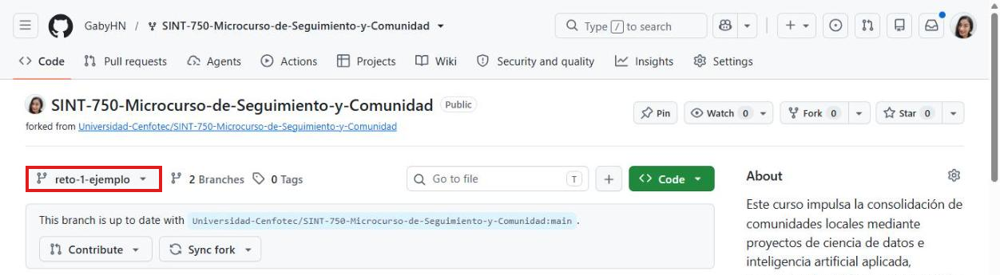
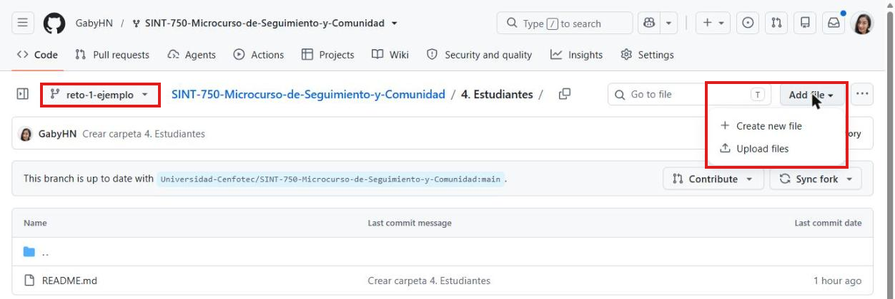
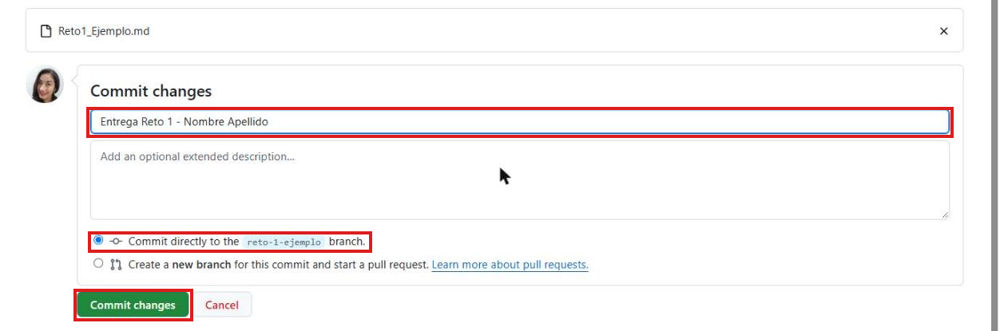
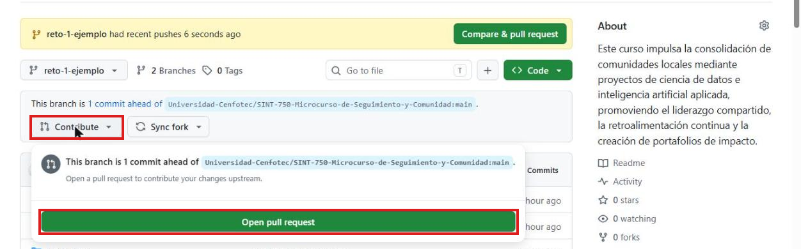
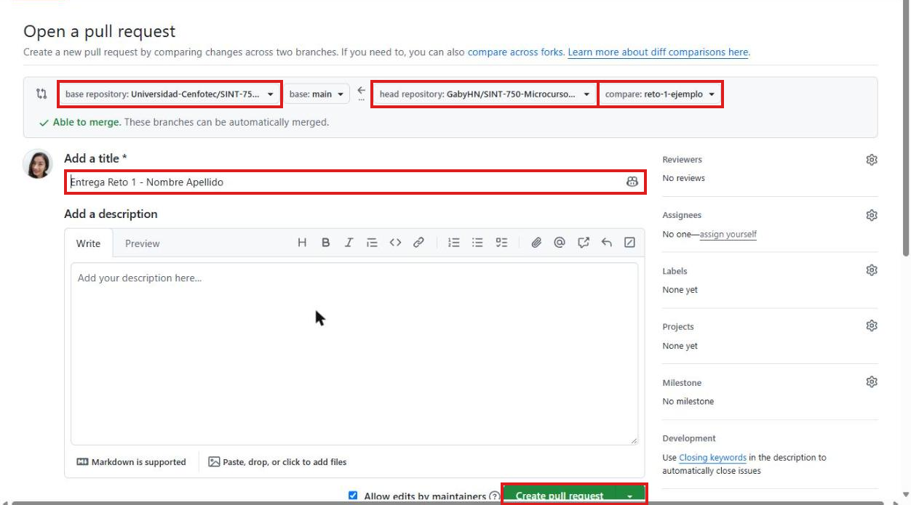

# Guía 2: Cómo entregar tus tareas (una rama por entrega)

Cada entrega se hace en **una rama nueva** de tu fork y se envía al **repositorio del curso** con un *pull request* (PR). Así cada PR trae **solo** los archivos de esa tarea. Al final copias el enlace del PR y lo subes a Moodle.

> Si todavía no tienes tu fork, sigue primero la [Guía 1](guia-fork.md).
> En los ejemplos usamos el usuario **GabyHN** y la rama `reto-1-ejemplo`; reemplázalos por tu usuario y tu rama.

## 1. Actualiza tu fork (siempre desde `main`)

1. Entra a tu fork y verifica que el selector de rama diga **`main`**.
2. Haz clic en **Sync fork → Update branch**.
   Si dice *This branch is not behind the upstream*, ya está al día.



## 2. Crea la rama de la entrega

1. Haz clic en el selector de rama (dice `main`).
2. Escribe el nombre de la rama: `reto-N-nombre-apellido` (por ejemplo, `reto-1-ana-mora`).
3. Haz clic en **Create branch reto-N-... from main**.



4. **Verifica** que el selector ahora muestre el nombre de tu rama, **no** `main`.



## 3. Sube tu tarea a esa rama

1. Sin cambiar de rama, entra a la carpeta que corresponde:
   - Tarea individual: `4. Estudiantes` → tu carpeta (si no existe, créala con tu nombre).
   - Tarea grupal: `6. Grupos` → la carpeta de tu grupo.
2. Revisa otra vez que el selector diga tu rama y haz clic en **Add file → Upload files**.

   

3. Arrastra tus archivos y escribe el mensaje, por ejemplo: `Entrega Reto 1 - Nombre Apellido`.
4. **Antes de confirmar, verifica** que diga **Commit directly to the `reto-N-...` branch**. Si dice `main`, detente y vuelve al paso 2.
5. Haz clic en **Commit changes**.

   

> Puedes subir más archivos a la misma rama las veces que necesites antes de abrir el PR.

## 4. Abre el pull request hacia el repositorio del curso

1. En tu fork, con tu rama seleccionada, haz clic en **Contribute → Open pull request** (o en el botón amarillo **Compare & pull request**).

   

2. **Revisa la barra de arriba:**
   - **base repository:** `Universidad-Cenfotec/SINT-750-...` y **base:** `main` ✅
   - **head repository:** tu usuario y **compare:** tu rama (`reto-N-...`) ✅
   - Si en *base repository* aparece tu usuario, cámbialo a `Universidad-Cenfotec/...` ❌
3. Ponle un título claro, por ejemplo: `Entrega Reto 1 - Nombre Apellido`.
4. Haz clic en **Create pull request**.



## 5. Revisa el enlace del pull request

Al crearlo, quedas en la página del PR. Mira la dirección en el navegador:

✅ **Correcto** (el PR está en el repositorio del curso):

```
https://github.com/Universidad-Cenfotec/SINT-750-Microcurso-de-Seguimiento-y-Comunidad/pull/25
```

❌ **Incorrecto** (el PR quedó en tu propio fork):

```
https://github.com/GabyHN/SINT-750-Microcurso-de-Seguimiento-y-Comunidad/pull/1
```

Si tu enlace empieza con tu usuario, cierra ese PR (**Close pull request**) y repite el paso 4 revisando el *base repository*.

> El número al final (`/pull/25`) cambia en cada entrega; lo importante es que empiece con `github.com/Universidad-Cenfotec/`.

## 6. Sube el enlace a Moodle

1. Copia el enlace completo del PR desde la barra del navegador.
2. Entra a la tarea correspondiente en Moodle.
3. Pega el enlace en la entrega y envíala.

> Si después te piden correcciones, súbelas a **la misma rama**: el PR se actualiza solo y el enlace en Moodle sigue siendo el mismo.

## Resumen rápido

| Paso | Dónde | Qué haces |
|---|---|---|
| 1 | Tu fork, rama `main` | Sync fork → Update branch |
| 2 | Tu fork | Creas la rama `reto-N-nombre-apellido` y verificas que estás en ella |
| 3 | Tu rama | Subes tus archivos; debe decir *Commit directly to the `reto-N-...` branch* |
| 4 | Tu rama | Contribute → Open pull request (base = Universidad-Cenfotec, compare = tu rama) |
| 5 | Página del PR | El enlace empieza con `github.com/Universidad-Cenfotec/` |
| 6 | Moodle | Pegas el enlace del PR |
