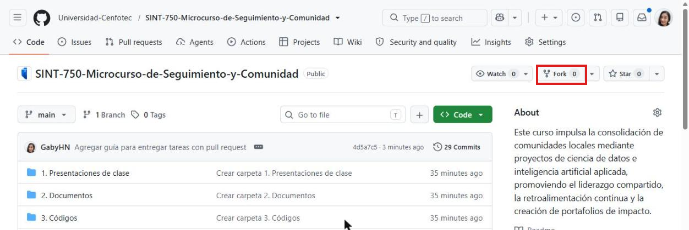
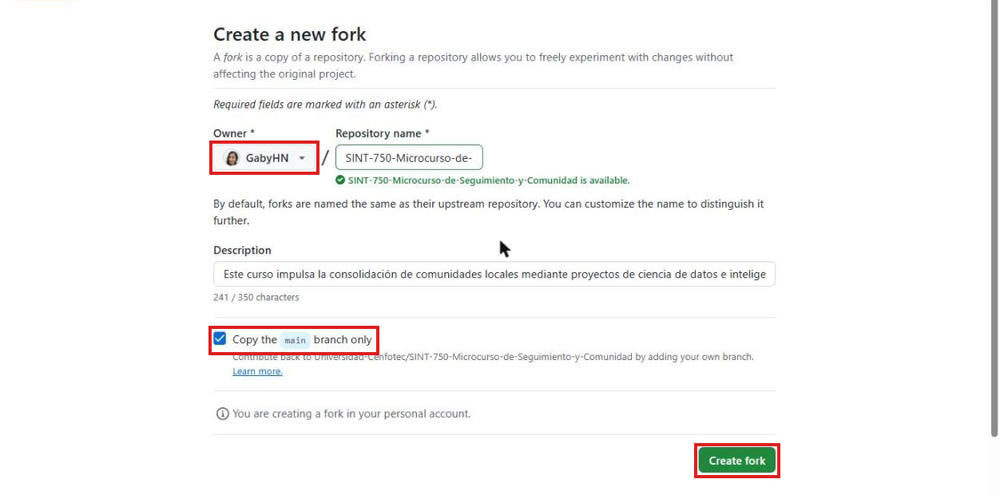
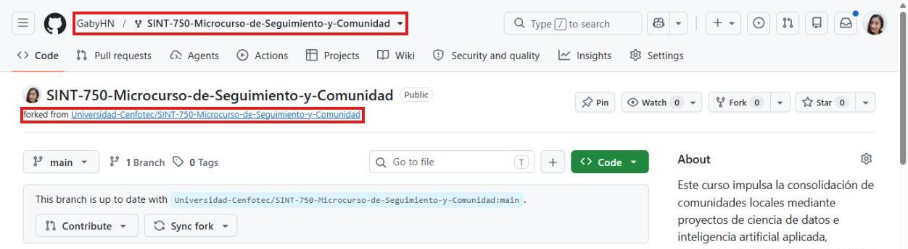
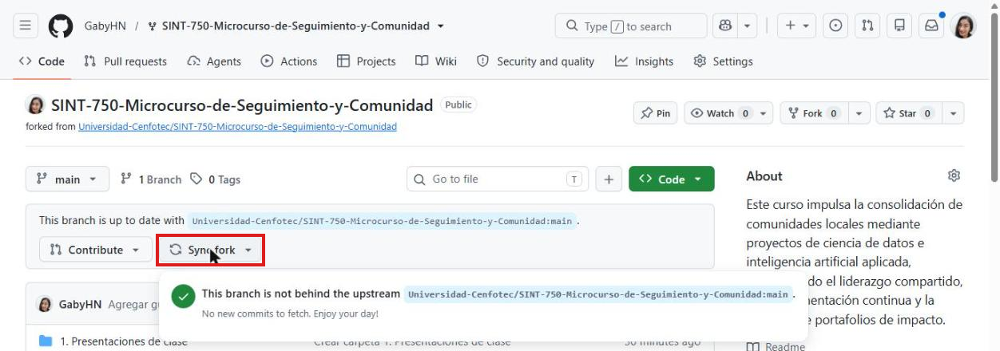

# Guía 1: Cómo crear tu fork del repositorio del curso

Un **fork** es una copia del repositorio del curso dentro de tu cuenta de GitHub. Ahí trabajas tus tareas y luego las envías al repositorio del curso con un *pull request* (ver [Guía 2](guia-entregas.md)).

> En los ejemplos usamos el usuario **GabyHN**. Cuando lo veas, reemplázalo por **tu** usuario de GitHub.

## Antes de empezar

- Ten una cuenta de GitHub. Si no tienes, créala en [github.com/signup](https://github.com/signup).
- Inicia sesión.

## Paso a paso

1. **Abre el repositorio del curso:**
   [github.com/Universidad-Cenfotec/SINT-750-Microcurso-de-Seguimiento-y-Comunidad](https://github.com/Universidad-Cenfotec/SINT-750-Microcurso-de-Seguimiento-y-Comunidad)

2. **Haz clic en el botón `Fork`**, arriba a la derecha.

   

3. En la pantalla *Create a new fork*:
   - **Owner:** elige tu usuario (por ejemplo, `GabyHN`).
   - **Repository name:** déjalo igual.
   - Deja marcada la opción **Copy the `main` branch only**.
   - Haz clic en **Create fork**.

   

4. **Verifica que quedó bien.** Debes estar en una página con esta dirección:

   ```
   https://github.com/GabyHN/SINT-750-Microcurso-de-Seguimiento-y-Comunidad
   ```

   Y debajo del nombre debe decir: *forked from Universidad-Cenfotec/SINT-750-Microcurso-de-Seguimiento-y-Comunidad*.

   

¡Listo! Solo se crea el fork **una vez** en todo el curso.

## Mantén tu fork actualizado

Antes de cada tarea, actualiza tu fork para tener lo más reciente del curso:

1. Entra a tu fork (`github.com/GabyHN/SINT-750-...`).
2. Haz clic en **Sync fork** y luego en **Update branch**.
   Si ya está al día, verás el mensaje *This branch is not behind the upstream*: no tienes que hacer nada.

   
